<p align="center">
  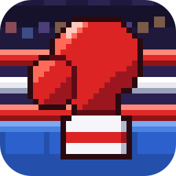
</p>

<h1 align="center">Super Punch-Out!!, native for Mac, Windows and Linux</h1>

<p align="center">
  The 1994 Super Nintendo boxing game, rebuilt as a real program for your computer.<br>
  Crisp pixels at any size, a proper launcher, controller support, and cheats.<br>
  <b>Free. Bring your own copy of the game.</b>
</p>

**Website:** [superpunchout.tanookistudios.com](https://superpunchout.tanookistudios.com)

## Download

| Your computer | Download | |
|---|---|---|
| **Mac** (Apple chip or Intel, macOS 11+) | [**SuperPunchOut-Mac.zip**](https://github.com/TanookiStudios/SuperPunchOutRecomp/releases/latest/download/SuperPunchOut-Mac.zip) | Signed and notarized by Apple |
| **Windows** (64-bit) | [**SuperPunchOut-Windows.zip**](https://github.com/TanookiStudios/SuperPunchOutRecomp/releases/latest/download/SuperPunchOut-Windows.zip) | |
| **Linux** (64-bit, most desktops from 2020 on) | [**SuperPunchOut-Linux.tar.gz**](https://github.com/TanookiStudios/SuperPunchOutRecomp/releases/latest/download/SuperPunchOut-Linux.tar.gz) | |

Every version and its notes are on the [Releases page](https://github.com/TanookiStudios/SuperPunchOutRecomp/releases).

## How to play

1. Download the version for your computer and unzip it.
   - **Mac:** drag **Super Punch-Out** into Applications (or anywhere) and double-click it.
   - **Windows:** open the folder and double-click **SuperPunchOut.exe**.
   - **Linux:** open the folder and double-click **SuperPunchOut** (or run `./SuperPunchOut`).
2. The launcher asks for your game file. Pick your own **Super Punch-Out!! (USA)** `.sfc` file.
   The launcher checks it and shows **ROM verified** when it's the right one.
3. Set any options you like (the **Game** button has the cheats and sound switches), then press **Play**.

No game files come with this download. You need your own copy of the cartridge's data. The one that works is:

| | |
|---|---|
| Game | Super Punch-Out!! (USA) |
| SHA-256 | `a3d803b8c6b0b6ac55085671040b840f993543915c7f802e14fb651beabe9b63` |

### Controls

| SNES | Keyboard |
|---|---|
| D-pad | Arrow keys |
| B | Z |
| A | X |
| Y | A |
| X | S |
| L | C |
| R | V |
| Start | Enter |
| Select | Right Shift |
| **Menu** | **Esc** |

**Controllers:** plug one in and play, no setup. Xbox, PlayStation (3, 4 and 5), Switch Pro and Joy-Con,
8BitDo, and over 2,000 other pads are recognized by name. Any other USB pad still works with a standard layout.
The keyboard keeps working alongside a controller. Everything can be remapped in **Settings**, and the
**Esc** menu opens from a controller with the Guide / Home button (or Select plus a click of the left stick).
Own mappings: put a `gamecontrollerdb.txt` in the settings folder
(Mac: `~/Library/Application Support/SuperPunchOut`, Windows and Linux: next to the program).

## What's in it

- **Native code.** The game's own program was translated into native code, so it runs as a real Mac, Windows or Linux app.
- **Crisp at any size.** Whole-number scaling keeps every pixel sharp, from a small window to a 4K screen.
- **Launcher.** Set everything before you play: display, sound, controls, cheats.
- **In-game menu (Esc).** Change settings, save and load states, reset the game, or close it.
- **Sound.** Volume, and a mute switch for each of the Super Nintendo's eight sound voices.
- **Cheats.** A full super meter, can't be hit, infinite tries, start against any fighter, and skip to the next fight.

## Screenshots

<p>
  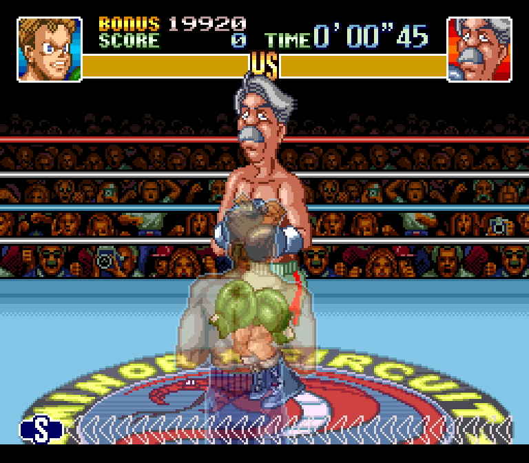
  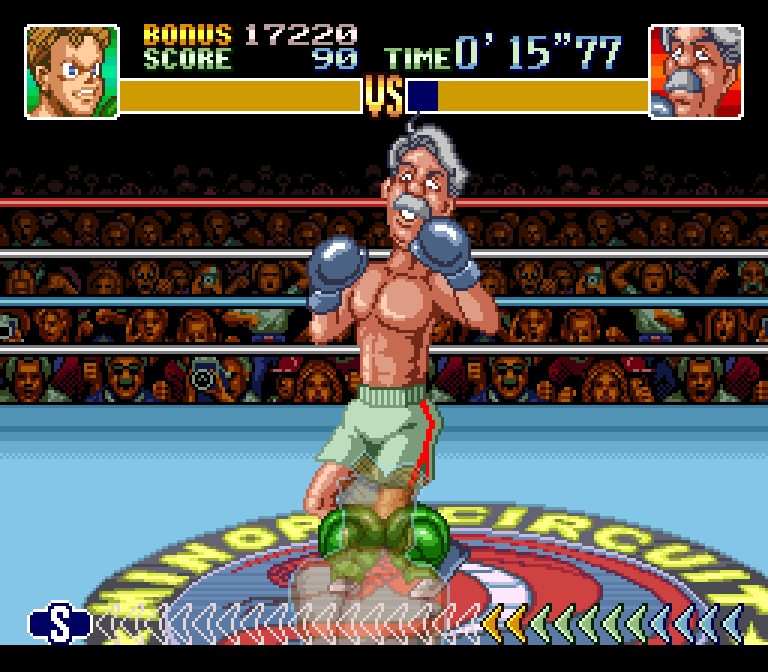
  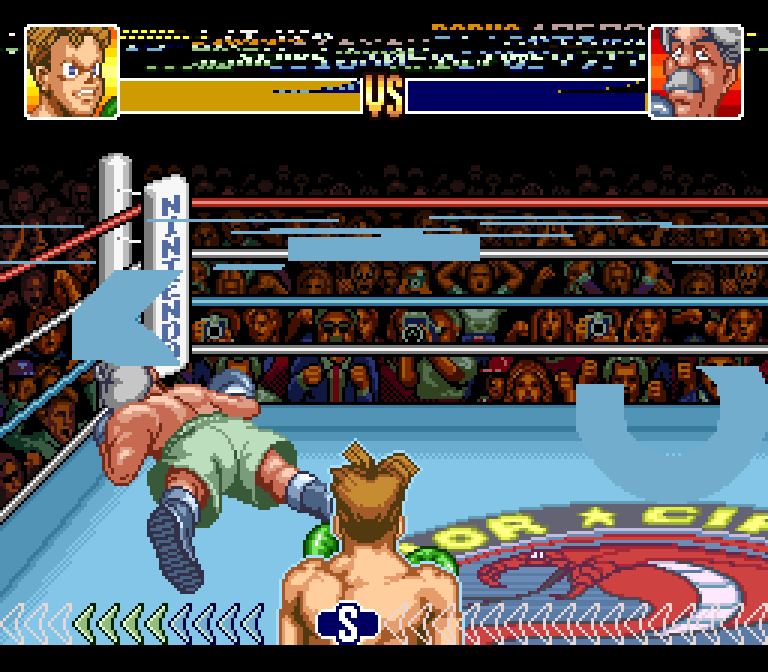
</p>
<p>
  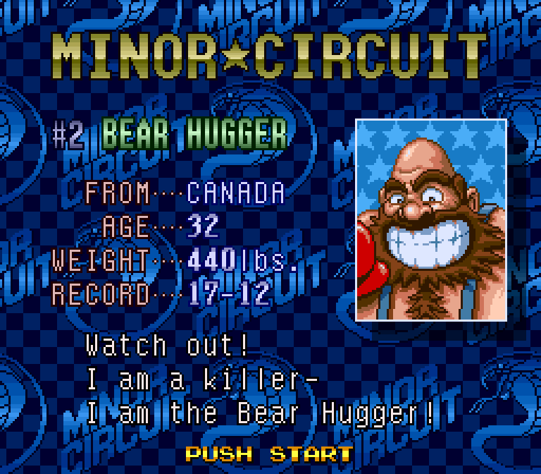
  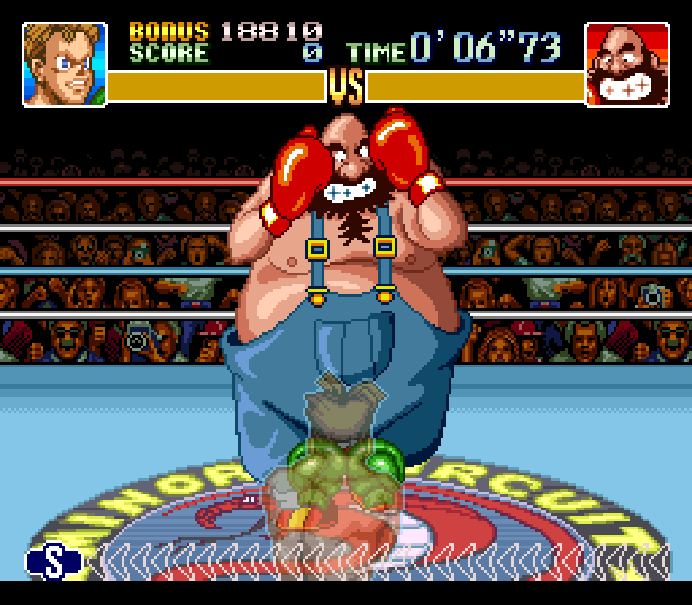
  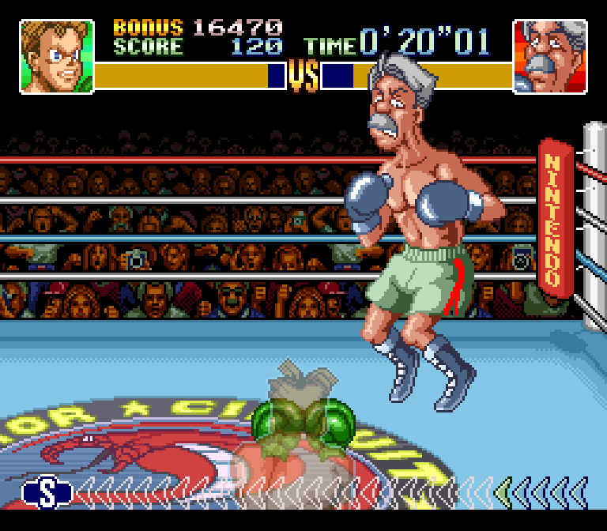
</p>
<p>
  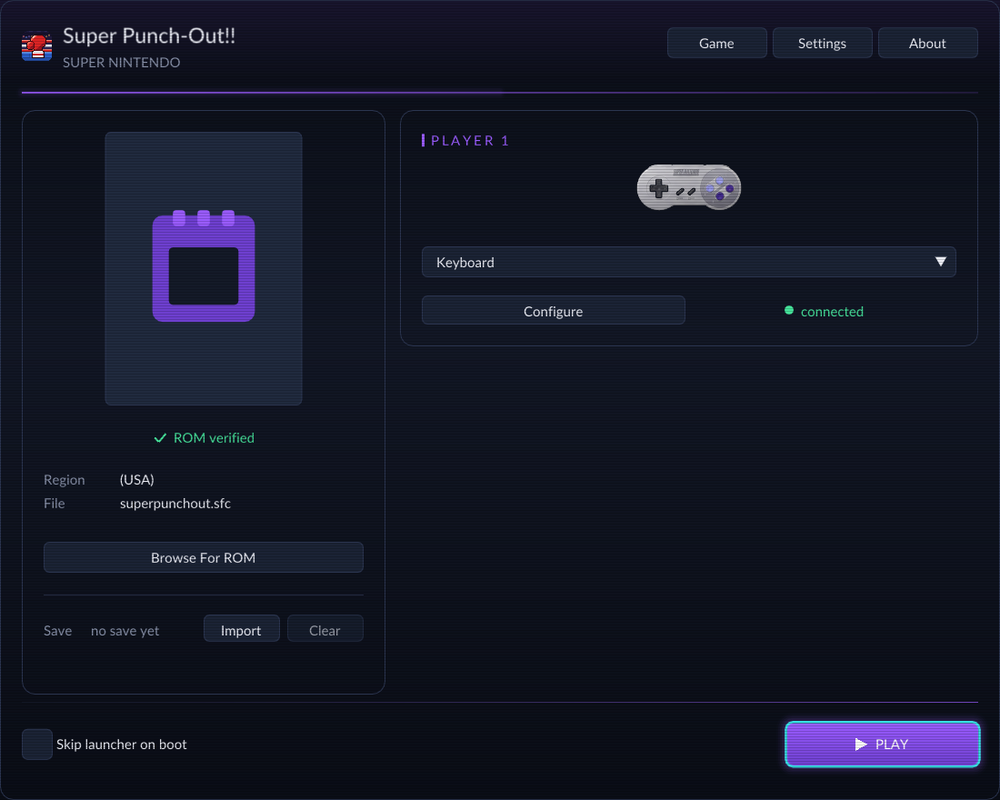
  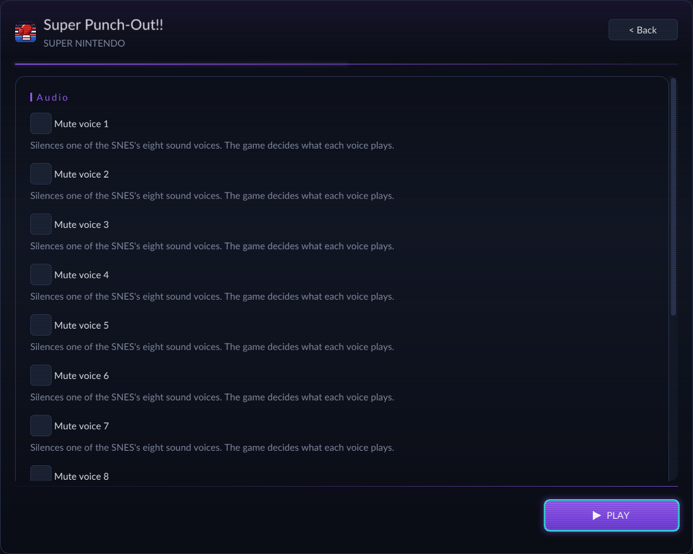
</p>
<p>
  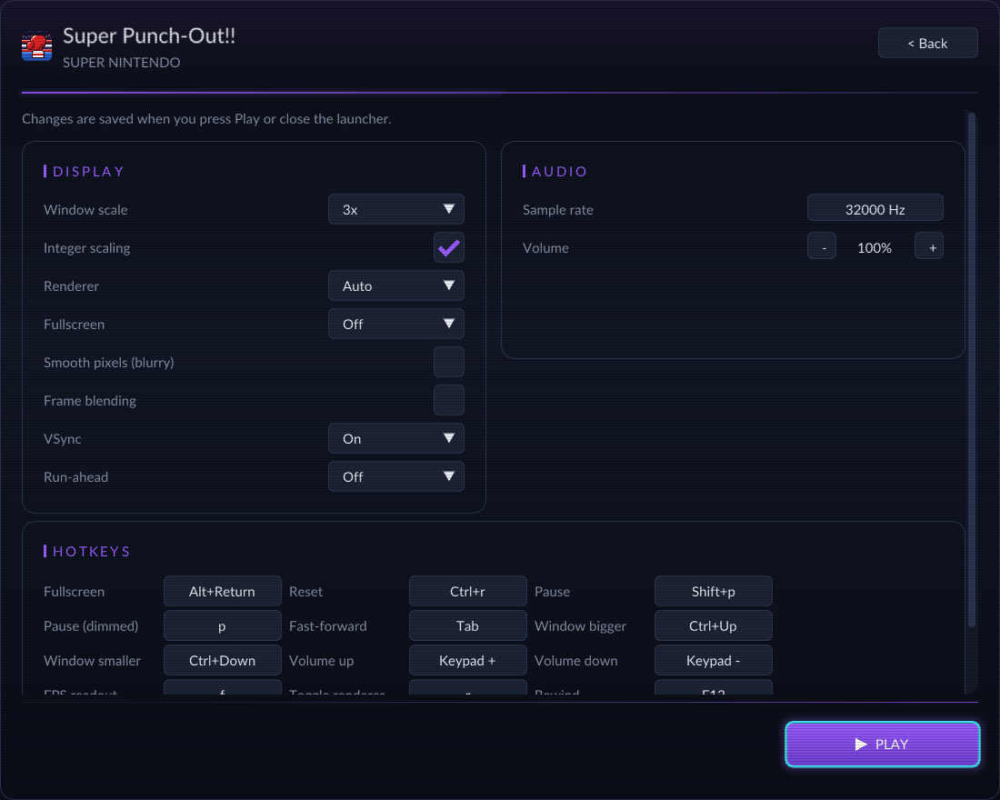
  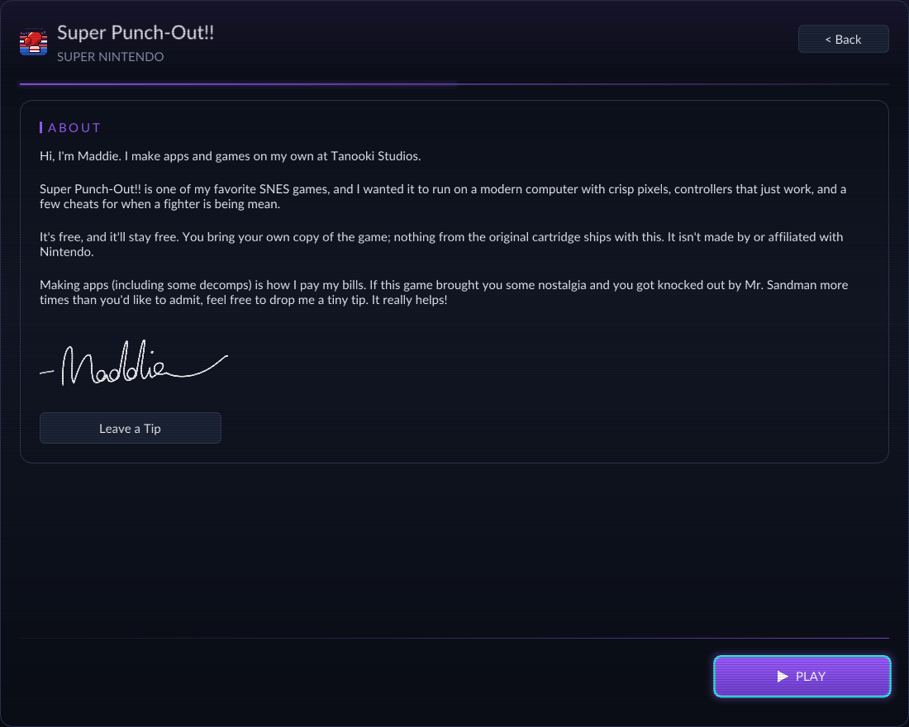
</p>
<p>
  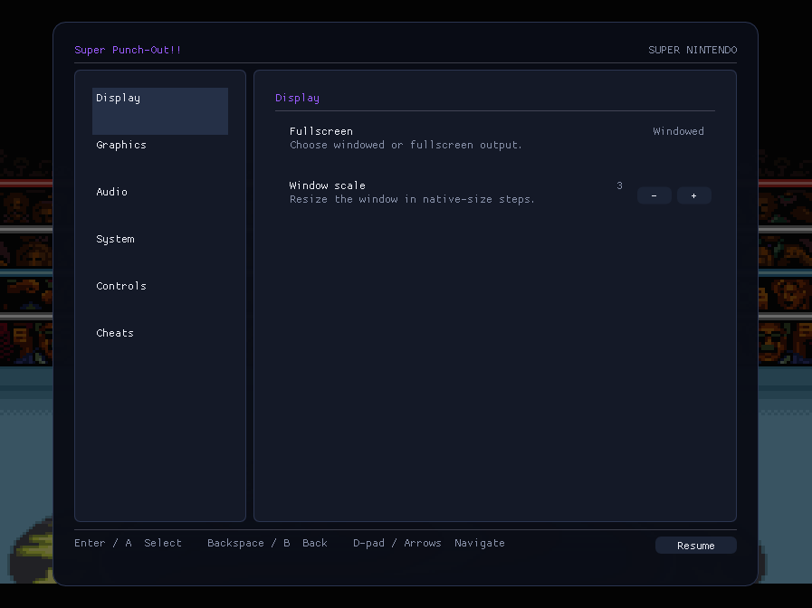
  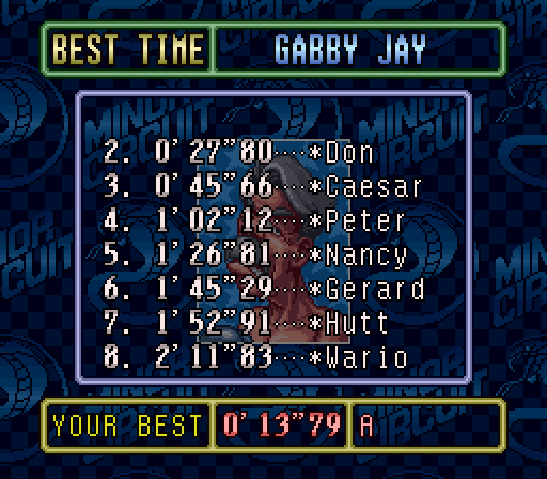
</p>

## Building it yourself

You need your own ROM for this too: the build reads it to translate the game, and nothing from it is stored in this repository.

```sh
./setup.sh                                  # fetches the engine at the tested versions and applies patches/
cp "/path/to/Super Punch-Out!! (USA).sfc" rom/superpunchout.sfc
bash tools/regen.sh                         # translates your ROM into C (kept out of git)
cmake -S . -B build -G Ninja -DCMAKE_BUILD_TYPE=Release
cmake --build build
```

Release builds: `tools/make_app.sh --notarize` (Mac), `tools/make_windows_zip.sh` (Windows, cross-built on a Mac),
`tools/make_linux.sh` (Linux, built in an Ubuntu 20.04 container). Screenshots: `tools/capture-screenshots.sh`.

## About Maddie

Hi, I'm Maddie. I make apps and games on my own at [Tanooki Studios](https://tanookistudios.com).

Super Punch-Out!! is one of my favorite SNES games, and I wanted it to run on a modern computer with crisp pixels,
controllers that just work, and a few cheats for when a fighter is being mean.

It's free, and it'll stay free. Making apps (including some decomps) is how I pay my bills. If this game brought you some nostalgia and you got knocked out by Mr. Sandman more times than you'd like to admit, feel free to drop me a tiny tip. It really helps!


**[Leave a Tip](https://tanookistudios.com/SupportMe)**

## Credits and legal

- Built on [snesrecomp](https://github.com/mstan/snesrecomp) by Matthew Stanley (PolyForm Noncommercial 1.0.0)
  and [recomp-ui](https://github.com/mstan/recomp-ui) (MIT), with [SDL](https://libsdl.org) (zlib) and
  [Dear ImGui](https://github.com/ocornut/imgui) (MIT), and the [SDL_GameControllerDB](https://github.com/mdqinc/SDL_GameControllerDB) controller list (zlib). Full texts: [THIRD_PARTY_NOTICES.md](THIRD_PARTY_NOTICES.md).
- This project's own code is under the [PolyForm Noncommercial License 1.0.0](LICENSE). It may never be sold.
- Super Punch-Out!! and Super Nintendo are trademarks of Nintendo, which published the game. This project is not made by,
  endorsed by, or affiliated with Nintendo. It contains no game data: you supply your own.
